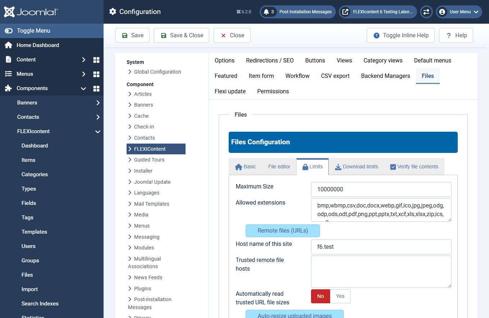

# Remote file hosts

FLEXIcontent can store a file as a URL instead of an upload. When the server itself has to request such a URL (to read the file size, or to pass the download through the site), it only does so for public HTTP(S) hosts on the standard ports. Two options widen that rule.

They are in **Components → FLEXIcontent → Configuration → Files → Limits**, under **Remote files (URLs)**.

## Host name of this site

URL files that point to this host are allowed even when the site uses a private network address or a non-standard port, as a local or intranet site does.

- If `live_site` is set in `configuration.php`, the host of that URL is used and this option is ignored.
- Otherwise this option is used. While it is empty, it is filled in with the host name that a configuration administrator uses when opening the FLEXIcontent dashboard.
- Change it if the site is reached under another name. Enter one host name, without `https://`.

The host name of a visitor's request is never used for this. A visitor can send any host name, so the value has to come from the configuration.

## Trusted remote file hosts

Other servers that hold your files, one per line.

- `files.example.com` allows that host on every port.
- `files.example.com:8443` allows only that port.
- A listed host may use a private network address.

When this list has entries, downloads are passed through the site only for the listed hosts and the site's own host. Other URL files still work: the visitor's browser is sent to the URL directly.
